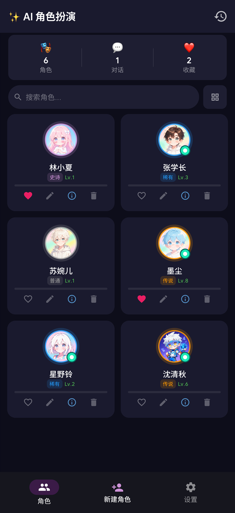
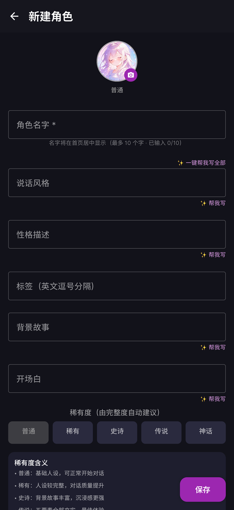
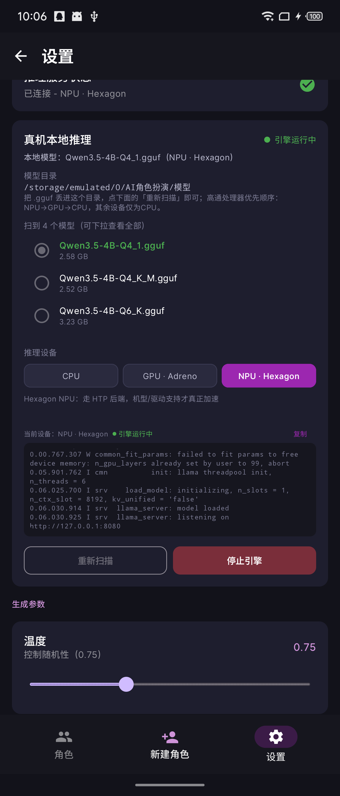
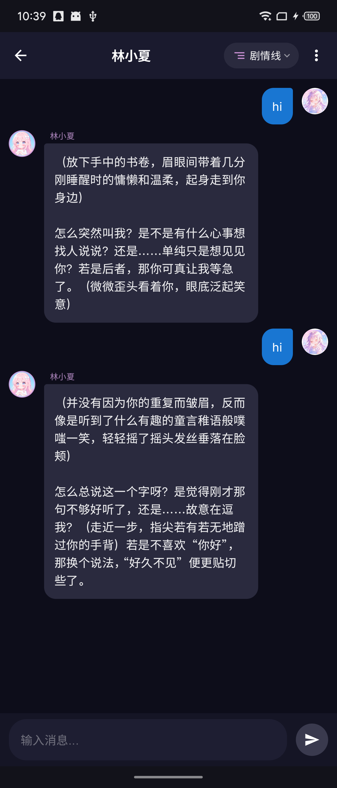
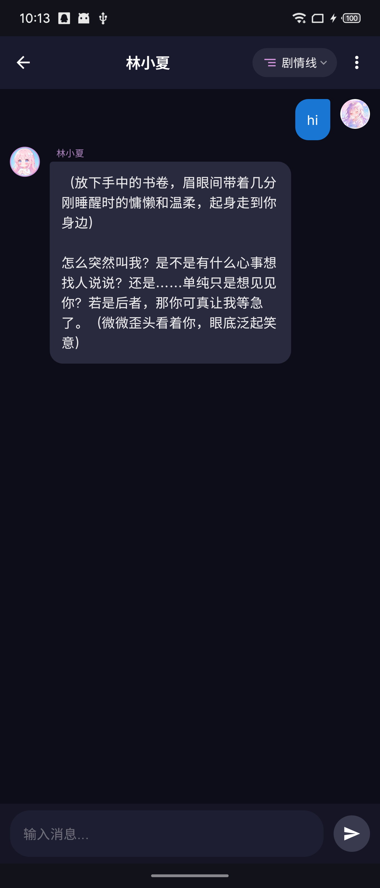
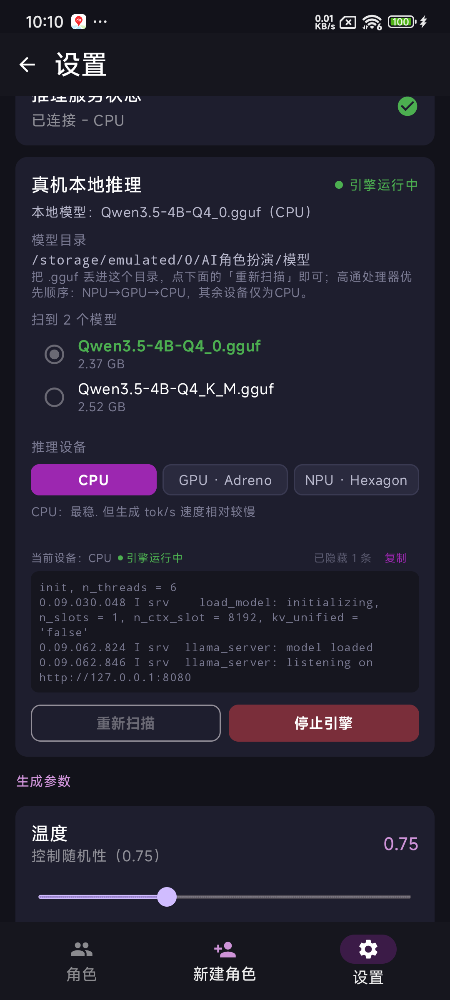

# AI 角色扮演（离线本地推理）

完全离线的 Android 角色扮演 App：角色卡、多轮对话、长期记忆、手机上本地跑 GGUF 大模型。

本地推理 · 完全离线 · 数据不出手机 · 无需服务器 · 支持 CPU / GPU / NPU 三档

## 界面预览

真机实拍（魅族 21 Pro / 骁龙 8 Gen 3）：

| 首页 · 角色列表 | 新建角色 |
| --- | --- |
|  |  |

## 真机实测

两台真机的实际运行截图（魅族 21 Pro / 骁龙 8 Gen 3 / SM8650 与红米 K40 / 骁龙 888 / SM8350）—— 模型加载、引擎起服务、逐字生成全部在手机本机完成，全程不联网：

| 魅族 21 Pro · NPU · Hexagon 档跑通 | 魅族 21 Pro · GPU · Adreno 档真实对话 |
| --- | --- |
|  |  |

| 魅族 21 Pro · NPU 档真实对话回复 | 红米 K40 · CPU 档跑通（armv8.2 自编库无 SIGILL） |
| --- | --- |
|  |  |

## 功能概览

- 角色卡：姓名、性格、说话风格、背景故事、开场白、标签与稀有度，支持 AI 批量补全
- 多轮对话：流式输出、停止生成、按角色区分「思考中」、剧情线自定义名称
- 长期记忆：从对话里按确定性规则抽取事件 / 偏好 / 事实，可在记忆页逐条查看与编辑
- 本地推理：内置骁龙 llama.cpp 引擎，模型放在手机里，全程不联网
- 数据自主：JSON 整体导出 / 导入备份，可清空全部对话与记忆

## 推理设备支持

- 高通骁龙处理器（含 Adreno GPU、Hexagon NPU）：部分支持CPU、GPU、NPU三档推理，优先顺序为NPU→GPU→CPU。引擎起不来时 App 会说明原因并自动回退到下一档；实测魅族 21 Pro（SM8650）三档全部可用（4B-Q4：NPU 生成约 11.5 tokens/s、GPU 7.6、CPU 8.1），红米 K40（888，DSP 只有 v68）NPU 档提示后回退、CPU 档 4B-Q4 生成约 5～6 tokens/s。
- 其它处理器：仅支持 CPU 推理，速度较慢

## 环境要求

- Windows 系统（打包脚本为 PowerShell 与批处理；Linux 或 macOS 需自行安装 Gradle 8.2）
- JDK 17
- Android SDK：compileSdk 34、minSdk 26、targetSdk 34
- Gradle 8.2（仓库自带 wrapper，无需另装）、AGP 8.2.0、Kotlin 1.9.20
- 首次构建需要联网下载依赖

## 引擎库准备（构建真机包前必做）

真机包内置的骁龙引擎库（`engine/android-snapdragon/jniLibs/arm64-v8a`，共 27 个文件 / 约 246 MB）
**不进本仓库** —— 其中既有本项目自编的产物，也有来自上游与设备的高通闭源库，体积与许可都不适合入库。
缺了它们 `:app:assemblePhysRelease` 会在打包阶段提示缺少 jniLibs。

- **方式一 · 下载现成压缩包（最快）**：从 [Releases](https://github.com/TomCatMouse/offline-ai-roleplay/releases/latest)
  下载 `engine-libs-arm64-v8a-b11558.zip`（59 MB），在项目根目录新建 `engine\android-snapdragon\` 后解压进去
  （包内就是 `jniLibs/arm64-v8a/`），解压后即 `engine/android-snapdragon/jniLibs/arm64-v8a/` 下的 27 个 `.so`（sha256 以 `6E9B6F4C` 开头）。
- **方式二 · 自己编译（正统做法）**：完整配方、自检命令与踩坑记录见
  [`docs/android-armv8.2-engine-rebuild.md`](docs/android-armv8.2-engine-rebuild.md)，三个步骤展开如下。

<details>
<summary><b>👉 展开方式二：自编 16 个 + 取 8 个 + 取 1 个</b></summary>

<br>

1. **自编 16 个引擎库（最关键的一步）**：官方预编译包是 ARMv8.6 口径，在骁龙 855/865/870/888 上一启动就 SIGILL，
   必须自己编。按文档 **§1 源码准备 → §2 配置与构建（`armv8.2-a+dotprod`）→ §3 产物自检
   → §4 入库规则** 走一遍，把产物连同改名后的 `libllama-server.so`、取自 NDK clang 19 的 `libomp.so`
   一起放进 `jniLibs/arm64-v8a/`（本步合计 **18 个**）。
   ⚠️ 别漏 **§5.10**：`libggml.so` 必须带 Hexagon 后端注册宏，否则 NPU 档在**所有机型**上都不可用。
2. **取 Hexagon skel 与高通设备库（8 个）**：从上游 llama.cpp 的 Android snapdragon 预编译包里只取这几个 ——
   `libggml-hexagon.so`、`libggml-htp-v73/75/79/81.so`、`libcdsprpc.so`、`libvmmem.so`、`vndk_dsp_10.so`。
   CPU / OpenCL / llama 系列库**务必**用第 1 步的自编产物，别用官方包里的（原因见 §5.14）。
3. **取厂商 OpenCL 实现（1 个）**：`adb pull /vendor/lib64/libOpenCL.so`，直接以 `libOpenCL.so` 放进 jniLibs。
   包内无需附带其它高通闭源驱动 —— 驱动本体留在设备上，由该实现内部走 sphal 命名空间加载（§5.1–§5.5）。
   注意：这是厂商实现，受其自身许可约束，**再分发前请自行确认**。

</details>

18 + 8 + 1 = 27 个齐全后自检：

```
powershell -File scripts\setup-engine-libs.ps1
```

若提示脚本被禁止运行，改用 `powershell -NoProfile -ExecutionPolicy Bypass -File scripts\setup-engine-libs.ps1`。
看到「期望 27 ｜ 缺失 0 ｜ 多余 0」即可构建真机包。

> 只想先跑起来、不想折腾引擎？**默认包**（模拟器 / PC 引擎模式）完全不需要这些库：
> `gradlew.bat :app:assembleDebug`

## 构建步骤

1. 在项目根目录新建 `local.properties`，写入本机 SDK 路径：

   ```
   sdk.dir=D\:\\sdk
   ```

2. 常用命令（环境要求与常见问题另见 **[BUILD.md](BUILD.md)**）：

   ```
   gradlew.bat :app:assemblePhysRelease        # 真机包（内置骁龙引擎，只打 arm64-v8a）
   gradlew.bat :app:assembleDebug              # 默认包（模拟器 + PC 引擎，包内不含手机端引擎）
   powershell -File scripts\build-phys.ps1     # 真机包一键：编译 + 安装 + 截图冒烟测试
   powershell -File scripts\build-default.ps1  # 默认包一键（连 PC 引擎）
   ```

   默认包说明：测试环境为 win11+ 64 位操作系统 + x64 处理器；推理由 PC 上的 llama-server 完成，
   服务器地址填 PC 的局域网 IP（例如 192.168.1.100）。一键脚本加 `-SkipTest` 可跳过冒烟测试。

3. 产物位置：`app\build\outputs\apk\physRelease\` 与 `app\build\outputs\apk\debug\`

签名说明：正式版签名属性 `ROLEPLAY_KEYSTORE_FILE`、`ROLEPLAY_KEYSTORE_PASSWORD`、`ROLEPLAY_KEY_ALIAS` 放在 `~/.gradle/gradle.properties` 与密钥文件一起，均不进仓库；属性缺失时构建出的是未签名 APK，不影响编译通过。

## 目录说明

- `app/src/main`：默认包与真机包共用的主体代码（Compose 界面、Room 数据库、AI 服务）
- `app/src/phys`：真机包专属（本地引擎管理、所有文件访问权限、真机清单）
- `engine/android-snapdragon/jniLibs/arm64-v8a`：骁龙引擎库共 27 个（自编引擎库、Hexagon skel、厂商 OpenCL 实现等，详见上文「引擎库准备」）。**该目录不入库**，构建前请先取得
- `docs`：引擎自编配方 [`android-armv8.2-engine-rebuild.md`](docs/android-armv8.2-engine-rebuild.md) 与界面截图
- `scripts`：打包、版本管理、发布、PC 端模型切换器等脚本
- `tools`：开发期使用的测试与测量脚本
- `asset`：图标与立绘素材
- `BUILD.md` / `CHANGELOG.md` / `LICENSE`：构建说明 / 版本变更记录 / MIT 许可

## 模型

- 把 `.gguf` 文件放进手机的 `/storage/emulated/0/AI角色扮演/模型/`，再回设置页点「重新扫描」
- 下载地址：https://pan.quark.cn/s/14ce44be5923
- 建议 Q4_0 及以上量化：Q4_0 约 2.4 GB、Q4_K_M 约 2.5 GB（项目实测在用）、Q5_K_M 约 2.9 GB、Q6_K 约 3.2 GB
- 6 至 8 GB 内存机型选 Q4_0 或 Q4_K_M，8 GB 以上可上 Q5_K_M 或 Q6_K
- App 需要「所有文件访问权限」才能扫描模型目录（Android 11 及以上）

## 发布流程

1. `scripts\pack-release.ps1`：按源码指纹自动递增版本号并打出正式包到 `dist\正式版\`
2. `scripts\publish-release.ps1`：创建附注标签与 GitHub Release，上传 APK（需要环境变量 `GITHUB_TOKEN`）

版本变更记录见 **[CHANGELOG.md](CHANGELOG.md)**；最新安装包见 **[Releases](https://github.com/TomCatMouse/offline-ai-roleplay/releases/latest)**。

## 连通性自测

```
python test_http.py                       # 默认打 127.0.0.1（手机本地引擎）
set ROLEPLAY_HOST=192.168.1.100 && python test_http.py   # 打 PC 的局域网 IP
```

---

<div align="center">

## 💖 打赏支持

**如果这个项目帮到了你，可以请作者喝杯奶茶 🧋**

**你的一点心意，就是作者继续更新的动力 💗**

</div>

<details>
<summary><b>👉 点我展开打赏码（微信 / 支付宝）👈</b></summary>

<br>

<div align="center">

| 微信 | 支付宝 |
| --- | --- |
| [![微信收款码][qr-wechat]][qr-wechat] | [![支付宝收款码][qr-alipay]][qr-alipay] |

</div>

</details>

<!-- 参考式定义：表格里的 [qr-wechat] / [qr-alipay] 指向下面两个路径，
     这样长路径在文中只出现一次，单元格不会被长 URL 撑爆 -->

[qr-wechat]: app/src/main/res/drawable/reward_qr_wechat.jpg
[qr-alipay]: app/src/main/res/drawable/reward_qr_alipay.jpg
